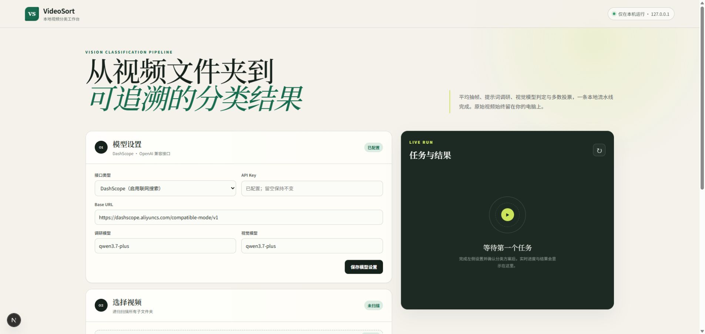

<div align="center">

# VideoSort

### 本地优先、可恢复、结果可追溯的视频分类工作台

从文件夹扫描、平均抽帧、分类方案生成，到视觉模型逐帧判定与视频级投票，全部汇聚在一个中文 Web 工作台中。

[](https://nextjs.org/)
[](https://react.dev/)
[](https://www.python.org/)
[](#环境要求)
[](#安全与隐私)

</div>



## 为什么使用 VideoSort？

批量视频分类不只是“调用一次视觉模型”。你还需要稳定抽帧、控制并发、约束输出格式、处理损坏视频、汇总帧级判断，并确保中断后不会重复消耗 API 费用。

VideoSort 将这些步骤组合为一条本地流水线：

- **文件夹直接处理**：浏览器无需上传大视频，服务端递归扫描本机目录。
- **模型辅助设计分类方案**：研究模型先生成类别定义、正反例线索、排除条件和逐帧提示词。
- **结果可人工确认**：分类方案可编辑，只有确认后才会执行视觉分析。
- **批处理可恢复**：每帧成功后立即落盘，取消、进程退出或服务重启后可继续。
- **结论可追溯**：保留采样时间、缩略图、帧级结果、错误信息、票数分布和最终类别。
- **原始素材零改动**：不会移动、复制、重命名或删除原始视频。

## 工作流程


每个视频被划分为 `N` 个等长时间区间，并在各区间中心点采样；当 `N = 1` 时取视频中间帧。图片保持宽高比，最长边缩放至不超过 **640 px**，再编码为 JPEG 发送给视觉模型。

## 核心能力

| 能力 | 说明 |
| --- | --- |
| 本机目录浏览 | 可通过 `VIDEO_ALLOWED_ROOTS` 限制允许访问的根目录 |
| 递归视频扫描 | 自动忽略符号链接和 `_video_classification` 输出目录 |
| 平均取帧 | 每视频支持 1–120 帧，记录目标与实际解码时间戳 |
| 分类方案调研 | DashScope OpenAI 兼容接口，研究请求显式启用联网搜索 |
| 并发视觉分析 | 每视频内部支持 1–8 路并发，默认逐视频推进 |
| 可靠模型调用 | 温度为 0、结构化解析、一次格式修复、指数退避重试 |
| 多数票决策 | `uncertain` 保留统计但不参与真实类别竞争；真实类别平票时结果为不确定 |
| 实时进度 | 通过 SSE 展示当前视频、完成帧数、失败数、票数和缩略图 |
| 取消与恢复 | 等待当前请求结束后安全停止，并按成功帧检查点继续 |
| 多格式导出 | 输出 JSON、JSONL 与带 UTF-8 BOM 的 CSV，可直接用 Excel 打开 |

支持的视频扩展名：

```text
.mp4  .mov  .mkv  .avi  .webm  .m4v  .mpeg  .mpg
```

## 技术架构

```text
┌──────────────────────────────────────────────────────────────┐
│ Next.js / React                                              │
│ 目录浏览 · 参数配置 · 方案编辑 · SSE 进度 · 结果与缩略图      │
└──────────────────────────────┬───────────────────────────────┘
                               │ 启动子进程 / JSON Lines
┌──────────────────────────────▼───────────────────────────────┐
│ Python Worker                                                │
│ PyAV 解码 · 平均抽帧 · OpenAI 兼容调用 · 投票 · 增量持久化    │
└──────────────────────────────┬───────────────────────────────┘
                               │ HTTPS
┌──────────────────────────────▼───────────────────────────────┐
│ DashScope / OpenAI-compatible API                            │
│ 研究模型 + 视觉模型                                          │
└──────────────────────────────────────────────────────────────┘
```

| 层级 | 技术 |
| --- | --- |
| Web 工作台 | Next.js 16、React 19、TypeScript |
| 服务端接口 | Next.js Route Handlers、SSE |
| 视频 Worker | Python 3.11+、PyAV、Pydantic |
| 模型客户端 | OpenAI Python SDK、OpenAI 兼容接口 |
| 持久化 | JSON、JSONL、CSV、本地 JPEG 帧 |

PyAV 使用随包提供的 FFmpeg 解码能力，**无需在系统中单独安装 `ffmpeg`**。

## 快速开始

### 环境要求

- Windows 10 / 11
- Python 3.11 或更新版本
- Node.js 20 或更新版本
- 可用的 DashScope API Key，或其他满足项目请求格式的 OpenAI 兼容服务

### 1. 获取项目

```powershell
git clone https://github.com/WuWeiBin7/VAS.git
cd VAS
```

> 仓库为私有仓库时，需要使用有权限的 GitHub 账号完成认证。

### 2. 安装依赖

```powershell
.\scripts\setup.ps1
```

安装脚本会创建 `.venv`、安装 Python 包，并安装前端依赖。

### 3. 启动服务

```powershell
.\scripts\start.ps1
```

打开终端中显示的地址，默认是 [http://127.0.0.1:3000](http://127.0.0.1:3000)。应用仅监听本机回环地址。

## 模型配置

首次启动后，在页面的“模型设置”中填写：

| 字段 | 示例 | 用途 |
| --- | --- | --- |
| Provider | `dashscope` | 决定兼容接口的扩展参数 |
| Base URL | `https://dashscope.aliyuncs.com/compatible-mode/v1` | OpenAI 兼容端点 |
| API Key | `sk-...` | 本地保存，不通过配置接口回传明文 |
| 调研模型 | `qwen-plus` | 生成结构化分类方案与研究摘要 |
| 视觉模型 | `qwen-vl-plus` | 对抽取的单帧图像进行分类 |

配置文件模板见 [`config_example.json`](./config_example.json)。也可以使用环境变量：

```powershell
$env:DASHSCOPE_API_KEY = "sk-..."
$env:VAS_PROVIDER = "dashscope"
$env:VAS_BASE_URL = "https://dashscope.aliyuncs.com/compatible-mode/v1"
$env:VAS_RESEARCH_MODEL = "qwen-plus"
$env:VAS_VISION_MODEL = "qwen-vl-plus"
```

使用 `VIDEO_ALLOWED_ROOTS` 限制可浏览目录，多个根目录可用分号、逗号或换行分隔：

```powershell
$env:VIDEO_ALLOWED_ROOTS = "D:\Videos;E:\Datasets"
```

## 使用方法

1. 保存模型配置并执行连通性检查。
2. 选择包含视频的本机文件夹，等待递归扫描完成。
3. 设置每视频抽帧数和视觉请求并发数。
4. 输入分类目标，例如“区分视频为第一人称视角还是第三人称视角”。
5. 让研究模型生成分类方案，并人工检查类别定义与逐帧提示词。
6. 确认方案并启动任务，在右侧查看实时进度。
7. 在页面查看视频汇总，或从结果目录读取 CSV / JSONL。

### 投票规则

每个成功分类的非 `uncertain` 帧计一票，置信度只用于展示，不参与票数加权。

```text
第一人称：4 票
第三人称：1 票
uncertain：5 票

最终结果：第一人称（真实类别票数为 4 : 1）
```

以下情况最终结果为“不确定”：

- 所有成功帧都是 `uncertain`；
- 最高票的真实类别出现平票；
- 所有帧均分析失败。

## 结果与断点恢复

每个任务写入所选视频目录下的独立文件夹：

```text
_video_classification/<时间-任务ID>/
├── classification_plan.json   # 已确认方案与方案哈希
├── manifest.json              # 参数、状态、输入指纹与进度
├── summary.json               # 任务统计与视频汇总
├── frame_results.jsonl        # 每帧增量结果，恢复的事实来源
├── frames.csv                 # 逐帧表格
├── videos.csv                 # 视频级投票与最终类别
└── frames/
    └── <视频ID>/*.jpg         # 采样帧
```

成功帧写入后会立即更新检查点。恢复任务时，系统综合校验：

- 视频相对路径、文件大小和修改时间；
- 每视频采样帧数；
- 分类方案哈希；
- 已成功的帧索引。

只有输入和方案一致时才会跳过成功帧，从而避免重复调用模型产生额外费用。

## 开发与验证

启动开发服务器：

```powershell
npm run dev
```

运行后端测试、前端检查和生产构建：

```powershell
.venv\Scripts\python.exe -m pytest --basetemp .pytest-tmp
npm run lint
npm run build
```

测试覆盖采样位置、方案解析、模型响应修复、重试、投票、目录扫描、损坏视频、端到端事件顺序以及中断恢复。

## 安全与隐私

- 服务默认仅监听 `127.0.0.1`，不要将其代理到局域网或公网。
- `config.json`、`.env`、虚拟环境、运行数据和构建产物均已加入 `.gitignore`。
- 配置接口只返回 API Key 的“已配置”状态，不返回或记录明文。
- 原始视频不会离开本机，也不会被修改。
- **抽取后的 JPEG 帧会发送给你配置的视觉模型 API**，请根据素材敏感等级选择合规的模型服务。
- 目录浏览接口和帧预览接口都执行路径边界检查。

## 当前边界

VideoSort 第一版定位为单用户、本机批处理工具，暂不包含：

- 登录和多用户权限系统；
- 局域网或云端部署；
- 自动移动、复制、重命名或删除原始视频；
- 按最终类别自动整理素材；
- 多个批处理任务同时运行。

## 常见问题

<details>
<summary><strong>为什么不直接把整个视频发送给模型？</strong></summary>

平均抽帧能显著降低传输量、调用成本和上下文复杂度，也更容易保留逐帧证据并支持断点恢复。它适合主要依赖视觉内容的粗粒度分类；若任务强依赖动作顺序、声音或长时上下文，需要扩展为时序或多模态方案。

</details>

<details>
<summary><strong>为什么损坏视频不会让整个任务失败？</strong></summary>

Worker 将单视频、单帧错误记录到结果文件后继续批次。这样大型目录中少量异常文件不会阻塞其他可处理视频。

</details>

<details>
<summary><strong>修改分类方案后能继续旧任务吗？</strong></summary>

不能直接复用旧方案的成功帧。方案哈希变化后应创建新任务，避免把不同判定标准的结果混在一起。

</details>

---

<div align="center">

如果这个项目对你的本地视频整理流程有帮助，欢迎在仓库中提交 Issue 或改进建议。

</div>
